<p align="center">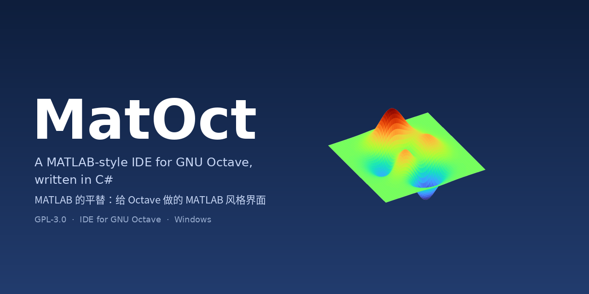</p>

<p align="center">
  <a href="LICENSE"></a>
  <a href="https://github.com/xinren1230/MatOct/releases/latest"></a>
  <a href="https://github.com/xinren1230/MatOct/releases"></a>
  
  
  
</p>

<p align="center"><b>MatOct</b> — a MATLAB-style IDE/interface for GNU Octave, written in C#.<br>
<b>MatOct</b> —— MATLAB 的平替，给 Octave 做的 MATLAB 风格界面（C# 编写）。</p>

<p align="center"><a href="#english">English</a> · <a href="#中文">中文</a></p>

---

## Quick start / 快速开始

1. Download **`MatOct-x.y.z-win-x64-setup.exe`** from **https://github.com/xinren1230/MatOct/releases/latest**
   从 Releases 页面下载 **`MatOct-x.y.z-win-x64-setup.exe`**：**https://github.com/xinren1230/MatOct/releases/latest**
2. Run the installer, then start **MatOct** from the Start menu. No .NET, MATLAB or Octave install needed.
   运行安装程序，从开始菜单启动 **MatOct**。无需安装 .NET、MATLAB 或 Octave。

A portable zip is attached to every release as well. / 每个版本也附带免安装 zip。

```matlab
>> x = linspace(0, 2*pi, 40);
>> plot(x, sin(x), '-o', 'LineWidth', 2, 'MarkerFaceColor', 'r'); grid on
>> title('Hello MatOct'); legend('sin x')
```

## Screenshots / 截图

| IDE main window / 主界面 | Workspace & variable editor / 工作区与变量编辑器 |
|---|---|
| 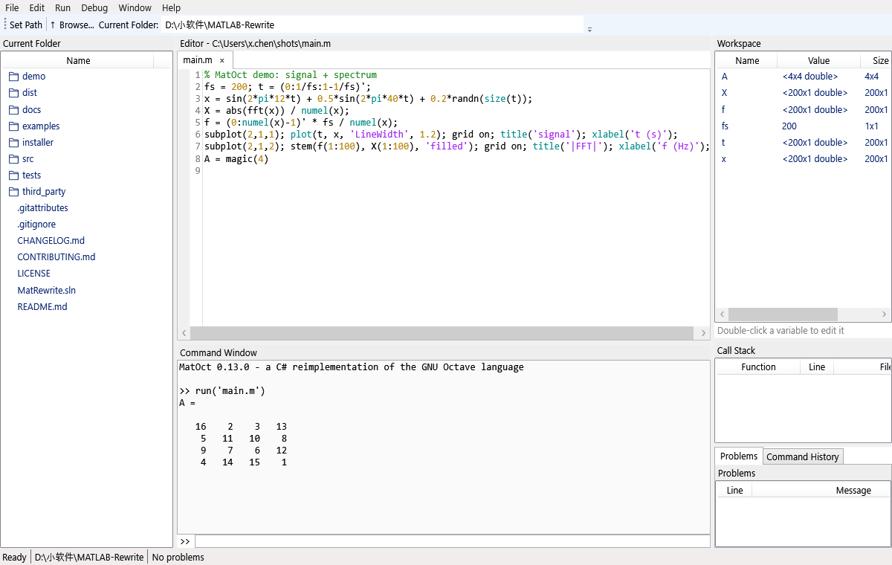 | 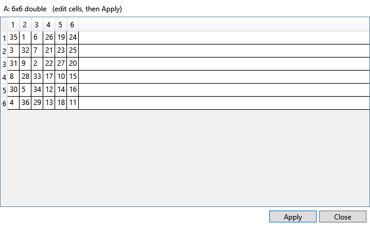 |
| **Property Inspector editing a line / 属性检查器编辑线条** | **Set Path dialog / 设置路径** |
| 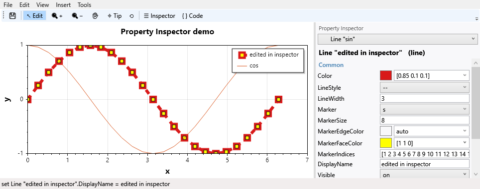 | 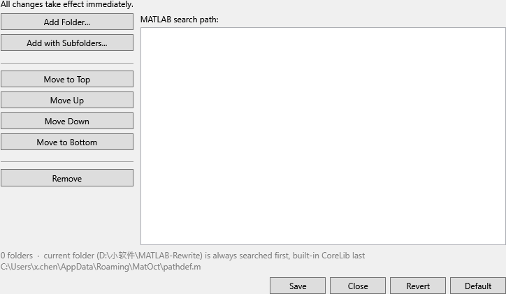 |

<p align="center">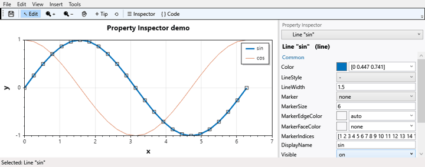<br><sub>Live editing in the figure Property Inspector / 在属性检查器中实时编辑</sub></p>

### Figures rendered by MatOct / 由 MatOct 生成的图形
All images below were produced by MatOct itself with `exportgraphics` — see [`docs/examples/gallery.m`](docs/examples/gallery.m).
以下图片均由 MatOct 自身通过 `exportgraphics` 生成。

| Styled 2-D lines / 线型与标记 | tiledlayout / subplot |
|---|---|
| 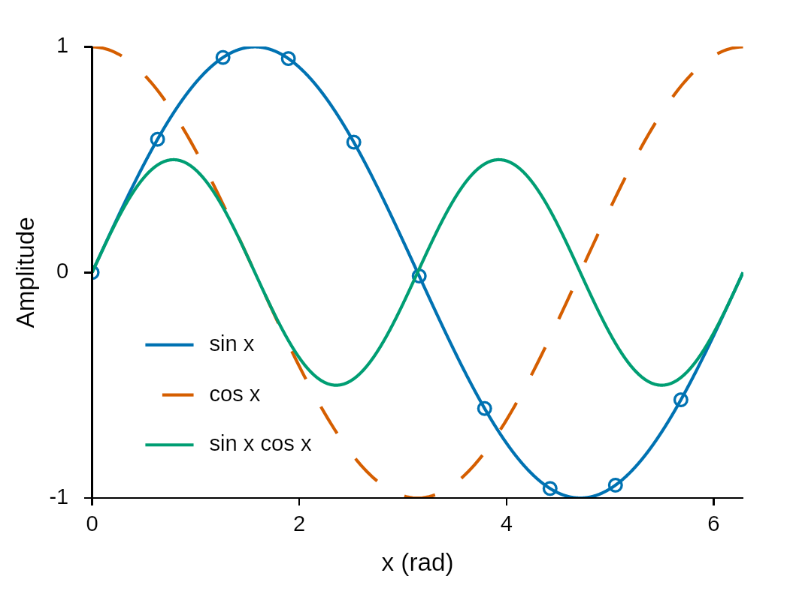 | 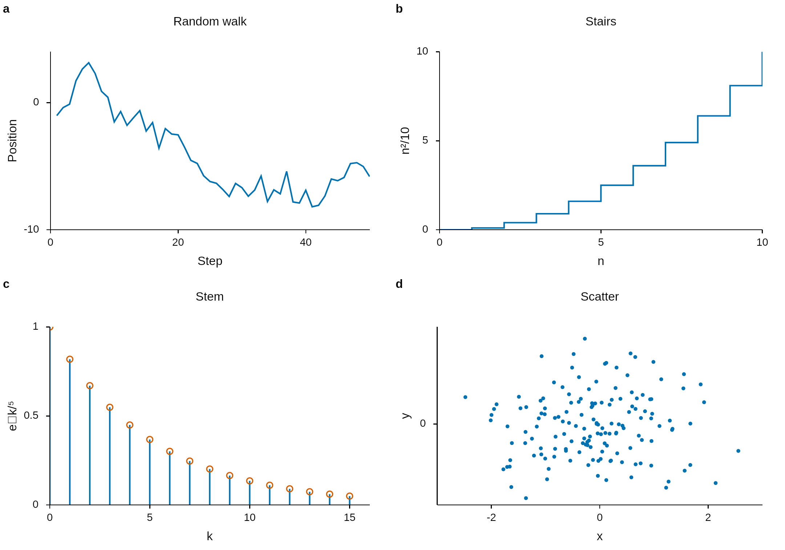 |
| **surf / mesh (3-D)** | **hist / bar / pie** |
| 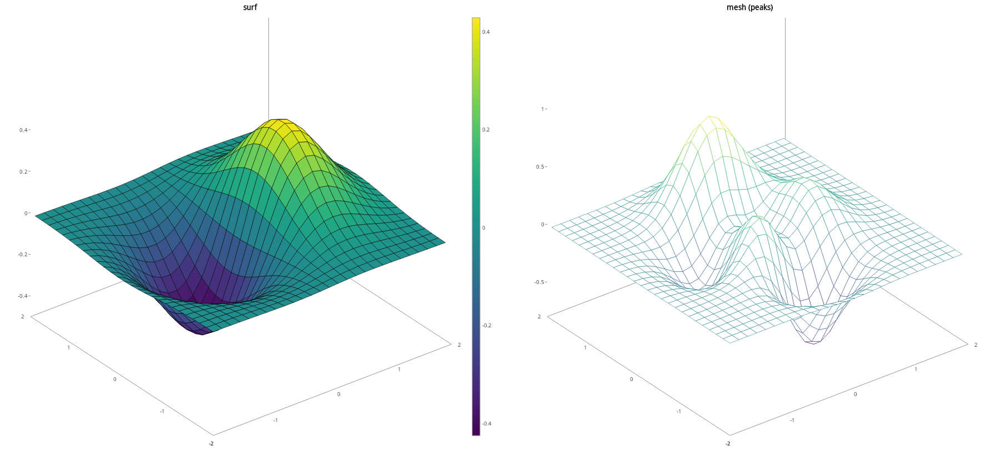 | 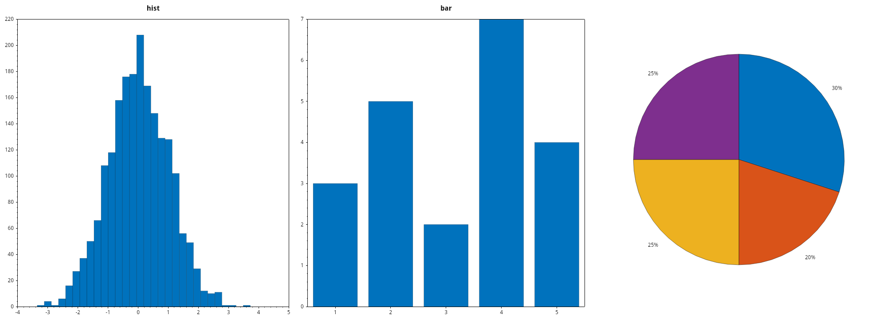 |
| **imagesc + colormap + colorbar** | |
| 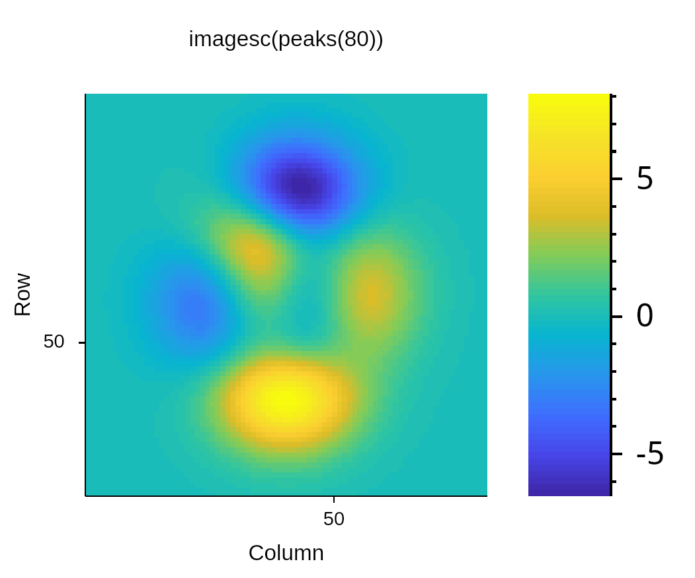 | |

### Publication style (Nature / Science) / 期刊出版风格
Figures use a clean journal look by default (Arial, 7–9 pt text, no box, outward ticks, Okabe-Ito colours, parula colormap, frameless legend).
`figstyle` switches presets and sizes figures to journal column widths; `exportgraphics`/`print` write exact physical sizes and DPI, and PDF/SVG stay vector.
默认采用简洁的期刊风格；`figstyle` 切换 Nature/Science 预设并按栏宽设定尺寸，`exportgraphics`/`print` 按毫米/厘米与 DPI 导出，PDF/SVG 为矢量。

<p align="center">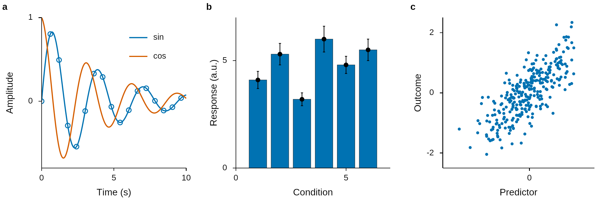</p>

```matlab
figstyle('nature', 'Columns', 2)        % 183 mm wide; also 'science', 'default', 'classic'
subplot(1,3,1); plot(t, y, '-o', 'MarkerIndices', 1:10:numel(t)); legend('sin','cos')
panellabel                               % bold a, b, c on every axes
exportgraphics(gcf, 'fig1.pdf')          % vector PDF at the preset width, fonts embedded
exportgraphics(gcf, 'fig1.png', 'Width', 89, 'Units', 'mm', 'Resolution', 600)
set(groot, 'DefaultAxesFontSize', 8)     % groot defaults work too
```

---

<a id="english"></a>
## English

### Features

| Area | What you get |
|---|---|
| Language | Full MATLAB/Octave syntax: matrices, cell arrays, structs, function handles, anonymous functions, nested/sub-functions, `classdef`-free OOP via `@class`, packages (`+pkg`), `private/`, `try/catch`, `unwind_protect`, `varargin/nargout`, `end` indexing, logical indexing |
| Numerics | ~1000 builtins + embedded Octave-style `.m` library: linear algebra (MathNet.Numerics), FFT, polynomials, interpolation, ODE solvers, optimisation, statistics, sets, sparse basics, integer types with exact int64 |
| Data types | `table`, `categorical`, `datetime`/`duration`, `string` helpers, `containers.Map`, JSON (`jsonencode`/`jsondecode`), missing-data helpers |
| Files | `load`/`save` (MAT v5/v7, text), `readtable`/`writetable`, `csvread`, `fopen`/`fprintf`/`fgetl`, `dir`, `copyfile`… |
| Graphics | `plot`, `scatter`, `bar`, `hist`, `pie`, `stairs`, `stem`, `area`, `errorbar`, `patch`, `fill`, `surf`, `mesh`, `contour`, `imagesc`, `image`, `subplot`, `tiledlayout`, `colormap`, `colorbar`, `legend`, `text`, `annotation`, full `set`/`get` handle graphics |
| Figure editor | Edit Plot mode, live **Property Inspector**, drag data points, data table, context menus, Insert menu, datatips, zoom/pan, export PNG/SVG/PDF, `.fig` save/open, **Generate Code** (`makemcode`) |
| IDE | Editor with syntax highlighting, completion and code sections, command window with history, workspace + variable editor, debugger (breakpoints, conditional breakpoints, step, call stack), Current Folder browser, Set Path dialog, help browser (`help`/`doc`/`lookfor`) |
| Search path | `addpath`/`rmpath`/`genpath`/`savepath`/`pathdef.m`/`userpath`/`which -all` exactly like MATLAB |
| CLI | `matoct` / `matrw` console: `>>` REPL, run scripts, `--eval`, headless figure export |

### Compatibility
Measured by running GNU Octave's own `%!test`/`%!assert` blocks from `scripts/` (864 files, ~10 000 blocks):

| Mode | Passed blocks | Rate |
|---|---|---|
| Core only (MatOct builtins + bundled Octave m-file library) | 9 590 / 10 356 | **92.6 %** |
| With Octave's `.m` source tree on the path (`--lib`) | 9 657 / 10 402 | **92.8 %** |

Details: [`docs/compat-core.md`](docs/compat-core.md), [`docs/compat-octave-lib.md`](docs/compat-octave-lib.md).

### Code examples

```matlab
% Linear algebra
A = magic(4); [Q, R] = qr(A); norm(Q*R - A)

% Tables and grouping
T = table([1;2;3;4], {'a';'b';'a';'b'}, 'VariableNames', {'v', 'g'});
G = findgroups(T.g); splitapply(@sum, T.v, G)

% Handle graphics — everything you can click in the Property Inspector is also scriptable
h = plot(1:10, rand(1,10));
set(h, 'Color', [0.85 0.1 0.1], 'LineStyle', '--', 'Marker', 's', 'MarkerFaceColor', 'y');
set(gca, 'FontName', 'Times New Roman', 'TickDir', 'out', 'YScale', 'log', 'XGrid', 'on');
savefig(gcf, 'my.fig'); close; openfig('my.fig');
makemcode(gcf, 'recreate_my_fig.m');           % File ▸ Generate Code
exportgraphics(gcf, 'my.pdf');                  % vector PDF (also .svg, .png)
```

### MatOct vs MATLAB vs GNU Octave

| | MatOct | MATLAB | GNU Octave |
|---|---|---|---|
| License | GPL-3.0, free | Commercial | GPL-3.0, free |
| Implementation | C# / .NET 9, single installer | C/C++/Java | C++/Fortran, Qt GUI |
| MATLAB IDE look & feel (workspace, variable editor, Set Path, debugger) | ✅ | ✅ | partial |
| Figure Property Inspector & Edit Plot | ✅ | ✅ | ❌ |
| Generate Code from figure | ✅ | ✅ | ❌ |
| `table` / `categorical` / `datetime` | basic | ✅ | partial |
| Toolboxes (Simulink, Signal, …) | ❌ | ✅ | via packages |
| Octave test-suite pass rate | 90 % out of the box | n/a | 100 % |
| Platforms | Windows (CLI/core cross-platform) | Win/macOS/Linux | Win/macOS/Linux |

### Roadmap
- [ ] More of the Octave test suite (target: 95 %)
- [ ] `classdef` classes
- [ ] Live scripts / notebook view
- [ ] More figure-editor tools (brushing, linked plots, arrows editable after insert)
- [ ] Read MATLAB binary `.fig` files
- [ ] Cross-platform GUI (Avalonia)
- [ ] Package manager (`pkg install`)

### Build from source
```powershell
git clone https://github.com/xinren1230/MatOct
cd MatOct
dotnet build MatRewrite.sln -c Release
dotnet test tests/MatRewrite.Tests -c Release
dotnet run --project src/MatRewrite.Ide                                   # IDE
dotnet run --project src/MatRewrite.Repl -- --eval "A=[1 2;3 4]; A\[1;2]"  # console
powershell -ExecutionPolicy Bypass -File installer\build-dist.ps1         # installer + zip
```
Requires the .NET 9 SDK (and Inno Setup 6 for the installer). Internal project and namespace names are `MatRewrite.*`.

### Contributing
Issues and pull requests are welcome — see [CONTRIBUTING.md](CONTRIBUTING.md) and [CHANGELOG.md](CHANGELOG.md).

---

<a id="中文"></a>
## 中文

### 功能

| 方面 | 内容 |
|---|---|
| 语言 | 完整的 MATLAB/Octave 语法：矩阵、元胞数组、结构体、函数句柄、匿名函数、子函数/嵌套函数、`@class`、`+pkg` 包、`private/`、`try/catch`、`unwind_protect`、`end` 索引、逻辑索引 |
| 数值计算 | 约 1000 个内置函数 + 内嵌 `.m` 函数库：线性代数、FFT、多项式、插值、ODE、优化、统计、集合运算、整数类型（int64 精确） |
| 数据类型 | `table`、`categorical`、`datetime`/`duration`、字符串函数、`containers.Map`、JSON、缺失数据处理 |
| 文件 | MAT v5/v7 读写、`readtable`/`writetable`、文本 I/O、文件操作 |
| 绘图 | 2D/3D 绘图、`subplot`/`tiledlayout`、`colormap`/`colorbar`/`legend`、完整的句柄图形 `set`/`get` |
| 图窗编辑器 | 编辑模式、实时**属性检查器**、拖动数据点、数据表格、右键菜单、插入菜单、数据提示、缩放/平移、导出 PNG/SVG/PDF、`.fig` 保存/打开、**生成代码** |
| IDE | 带语法高亮/补全/代码节的编辑器、命令窗口与历史、工作区与变量编辑器、调试器（断点、条件断点、单步、调用栈）、当前文件夹、设置路径、帮助浏览器 |
| 搜索路径 | 与 MATLAB 一致的 `addpath`/`savepath`/`pathdef.m`/`which -all` |

### 兼容性
运行 GNU Octave 自带的 `%!test` 测试块：安装即用（内置 Octave `.m` 函数库）**92.6%**（9590/10356），额外加载 Octave 源码树时 **92.8%**（9657/10402）。

### 与 MATLAB / Octave 的比较
MatOct 免费开源（GPL-3.0），界面与交互仿照 MATLAB（工作区、变量编辑器、设置路径、属性检查器、生成代码），一个安装包即可使用；不提供 Simulink 等工具箱，目前图形界面仅支持 Windows。详见上方英文对比表。

### 路线图
提高 Octave 测试通过率、`classdef`、实时脚本、更多图窗编辑工具、读取 MATLAB 二进制 .fig、跨平台界面、包管理器。

### 从源码构建 / 参与贡献
见上方 *Build from source*，以及 [CONTRIBUTING.md](CONTRIBUTING.md)。各阶段详细说明见 `docs/phaseN.md`（如 [docs/phase13.md](docs/phase13.md)）。

---

## License / 许可证
**GPL-3.0-or-later** — see [LICENSE](LICENSE).

MatOct is modelled on the language and behaviour of **[GNU Octave](https://octave.org)** and is distributed under the same GPL-3.0 terms. GNU Octave is Copyright © the Octave Project Developers. GNU Octave's GPL-3.0 m-file function library (`scripts/`) is bundled unmodified as embedded resources; no Octave C++ source is copied; Octave's test suite is used to measure compatibility. MATLAB is a registered trademark of The MathWorks, Inc.; MatOct is not affiliated with or endorsed by MathWorks.
Thanks to the GNU Octave project, [ScottPlot](https://scottplot.net), [MathNet.Numerics](https://numerics.mathdotnet.com), [AvalonEdit](https://github.com/icsharpcode/AvalonEdit) and SkiaSharp.

MatOct 以 GNU Octave 的语言与行为为蓝本，采用相同的 GPL-3.0 许可证发布；感谢 GNU Octave 项目及上述开源库。
